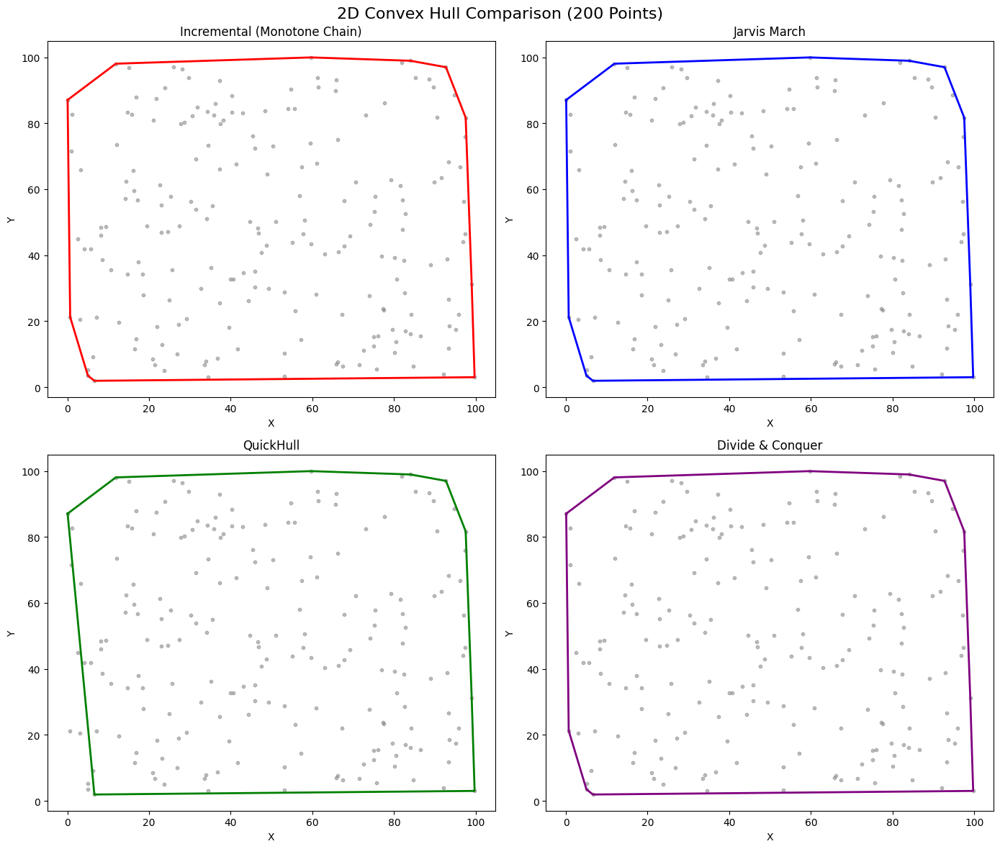
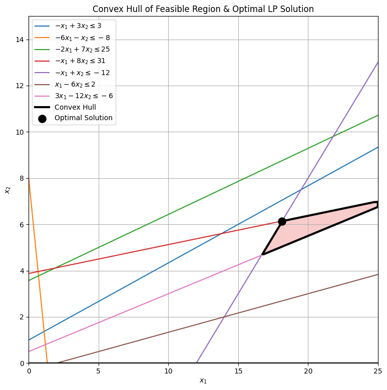
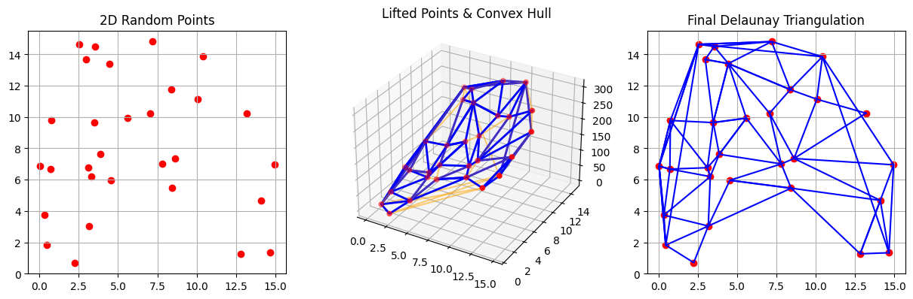
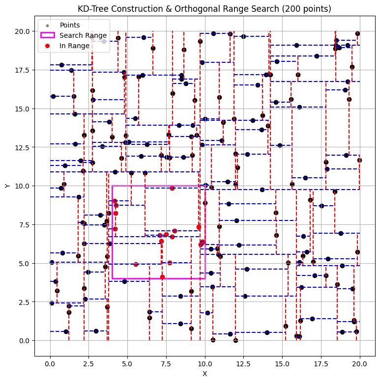

# Computational Geometry Algorithms in Python

Implementations, benchmarks and visualizations of classic computational-geometry algorithms: **convex hulls, linear programming, Delaunay triangulation and KD-trees**. Everything is in one Jupyter notebook: [`computational_geometry.ipynb`](computational_geometry.ipynb).

> *Computational Geometry* course (Dept. of Informatics & Telecommunications, University of Athens, Fall 2025).

## 1. Convex hull: four algorithms, implemented and compared

I implemented four 2D convex hull algorithms from scratch on top of an orientation (CCW) predicate:

| Algorithm | Complexity | N=50 | N=200 | N=500 | N=1000 |
|---|---|---|---|---|---|
| Incremental (Andrew's monotone chain) | O(n log n) | 0.15 ms | 0.62 ms | 1.76 ms | **3.33 ms** |
| Gift wrapping (Jarvis march) | O(n·h) | 0.29 ms | 2.05 ms | 4.12 ms | 8.28 ms |
| QuickHull | O(n log n) avg, O(n²) worst | 0.33 ms | 1.61 ms | 4.28 ms | 7.67 ms |
| Divide & Conquer | O(n log n) | 0.34 ms | 1.92 ms | 3.90 ms | 11.94 ms |



The notebook also includes a rotating **3D convex hull** animation.

## 2. Linear programming

Solves a 2D linear program by adding the constraints one at a time (with SciPy's `linprog`). It then plots every constraint, the feasible region (as the convex hull of the feasible grid points) and the optimal vertex.



## 3. Delaunay triangulation via lifting

Lifts the 2D points onto the paraboloid `z = x² + y²` and computes the 3D convex hull. Only the **lower-hull faces** are kept (the ones whose outward normal has `nz < 0`). Projected back down to the plane, these faces are exactly the **Delaunay triangulation**.



## 4. KD-tree & orthogonal range search

Builds a 2D **KD-tree** recursively (median split, alternating axes) and draws the space partition. It then answers **orthogonal range queries**, pruning every subtree whose region does not intersect the query rectangle.



## Running

```bash
pip install numpy scipy matplotlib jupyter
jupyter notebook computational_geometry.ipynb
```

**Tech:** Python · NumPy · SciPy · Matplotlib · Jupyter

## Author

**Giorgos Fragkakis** · [GitHub](https://github.com/fragk17)
